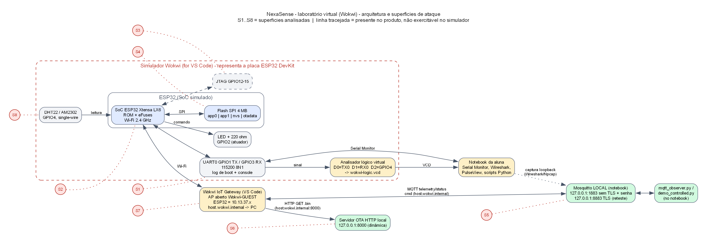

# NexaHome — Avaliação de segurança do NexaSense (IoT)

**Disciplina:** Hardware Hacking (IoT) · **Autora:** Camila Cesco Ferreira (RA 134666)
**Projeto no Wokwi:** local (Wokwi for VS Code)

## Objetivo

Avaliar o protótipo NexaSense antes do piloto: identificar superfícies de ataque em hardware, firmware,
comunicação e acesso físico, demonstrar de forma controlada uma condição insegura, classificar os riscos
e propor o hardening da versão comercial.

## Dispositivo analisado

ESP32 DevKit + DHT22 (GPIO4) + LED (GPIO2) **simulados no Wokwi**, rodando o firmware educacional
NexaSense `0.9.3-lab` (`firmware-src/src/main.cpp` = `wokwi/sketch.ino`), que reproduz o protótipo
descrito no case. O perfil `hardened` é usado no reteste. O enunciado permite dispositivo equivalente;
o que o simulador não cobre está em [`docs/limitacoes-ambiente-virtual.md`](docs/limitacoes-ambiente-virtual.md).

## Limites e escopo

Projeto próprio no Wokwi (Wokwi for VS Code), rede virtual Wokwi-GUEST e um broker MQTT **local**
(Mosquitto em `127.0.0.1`, alcançado pelo ESP32 simulado via `host.wokwi.internal`). Nenhum serviço
externo. Detalhes em [`docs/escopo-e-regras.md`](docs/escopo-e-regras.md).

## Arquitetura

 — detalhes em [`architecture/architecture.md`](architecture/architecture.md).

## Ferramentas

Wokwi (simulador, analisador lógico virtual, PCAP do Wi-Fi), Python 3 + paho-mqtt + scapy, Wireshark,
PulseView, Ghidra (opcional), scripts próprios em `scripts/`.

| Script | Etapa | Entrada → saída |
|---|---|---|
| `preserve_firmware.py` | 2 | .bin baixado → original somente leitura, SHA-256, `hashes.txt` |
| `analyze_firmware.py` | 3 | cópia de trabalho → `firmware_analysis.md` (partições, app_desc, assinatura, entropia, strings, segredos mascarados) |
| `vcd_uart_decode.py` | 4 | `wokwi-logic.vcd` → UART decodificada do sinal, baud estimado |
| `serial_capture.py` | 4 | texto do Serial Monitor (ou RFC2217/porta física) → log mascarado |
| `pcap_mqtt_summary.py` | 5 | `wokwi.pcap` → CONNECT/PUBLISH/SUBSCRIBE, DNS, destinos |
| `mqtt_observer.py` | 5 | assina a raiz própria e registra mensagens |
| `mqtt_connect_evidence.py` | 5 | CONNECT real ao broker → bytes com a credencial em claro (F05) |
| `demo_controlled.py` | 6 | comando LED on/off com a credencial obtida, resultado esperado × observado |
| `hash_evidence.py` | final | `EVIDENCE_MANIFEST.sha256` |

## Organização das evidências

```
architecture/   diagrama e superfícies S1–S8
firmware/       hashes.txt, analysis-notes.md, evidence/
hardware/       interface-map.md, evidence/ (prints, UART decodificada do VCD, logs mascarados)
network/        protocol-analysis.md, evidence/ (pcap_summary, observer)
findings/       findings.md, evidence/ (demonstração controlada)
remediation/    hardening-plan.md
firmware-src/   firmware para PlatformIO + wokwi.toml (Wokwi for VS Code) — fluxo principal
wokwi/          sketch.ino, diagram.json, libraries.txt (cópia para o Wokwi no navegador)
docs/           limitações, caso real, escopo, procedimento em placa física
lab/            broker MQTT local (ACL/TLS) e servidor OTA local
```

## Resumos

**Firmware.** Imagem de aplicação de 871.040 bytes, SHA-256 `d9d935b4…a7fa`; app sem assinatura Secure Boot V2 e não cifrada (entropia 7.05 bits/byte), `secure_version=0`; a credencial MQTT lida na UART (`nexasense`/senha da frota) aparece literal no binário no offset `0x13c5`; OTA por HTTP sem assinatura.

**Hardware.** UART0 a 115200 8N1 confirmada pelo sinal do analisador lógico (VCD); o log de boot verboso
expõe a configuração; o console de manutenção aceita `config` sem senha e entrega a credencial MQTT.
Download mode, Flash e JTAG analisados de forma estática/documental.

**Protocolos.** MQTT 3.1.1 sem TLS na 1883, com usuário e senha legíveis no CONNECT; a telemetria expõe
MAC e IP; o comando é aceito de qualquer cliente que tenha a credencial compartilhada; `/status` (HTTP) e
o OTA (HTTP, sem assinatura) ficam sem autenticação.

## Principais achados

| Achado | Risco | Validação |
|---|---|---|
| F02 Console UART sem autenticação entrega credenciais | Alto | dinâmica |
| F04 Credencial da frota embutida no firmware | Alto | dinâmica + estática |
| F05 MQTT sem TLS | Alto | dinâmica |
| F06 Uma credencial comanda qualquer unidade (demonstrado) | Alto | dinâmica |
| F07 OTA sem assinatura/anti-rollback | Alto | estática |

Lista completa em [`findings/findings.md`](findings/findings.md).

## Recomendações

Credencial única por dispositivo + ACL por device id; MQTT sobre TLS; remover console e logs de produção;
Secure Boot V2 + Flash Encryption (release) + Secure Download Mode + JTAG desabilitado em ESP32 revisão V3;
OTA assinado com anti-rollback; reteste em placa física antes do piloto.
Plano em [`remediation/hardening-plan.md`](remediation/hardening-plan.md).

## Como reproduzir

1. Compilar o firmware (`pio run -e lab` em `firmware-src/`), subir o Mosquitto local
   (`lab/mosquitto/mosquitto.conf`) e iniciar o Wokwi for VS Code.
2. Preservar o binário (`preserve_firmware.py`) e analisá-lo (`analyze_firmware.py --known-secret`).
3. UART: decodificar o VCD do analisador lógico (`vcd_uart_decode.py`, canais D0 e D1).
4. Rede: observar a telemetria (`mqtt_observer.py`) e evidenciar a credencial em claro no CONNECT
   (`mqtt_connect_evidence.py`); `/status` por `curl`.
5. Demonstração controlada do atuador (`demo_controlled.py`).
6. Fechar com o manifesto de integridade (`hash_evidence.py`).

Arquivos brutos (`*/evidence/raw/`, `firmware/original/*.bin`, `firmware/work/`) não são publicados;
as evidências publicadas têm as senhas mascaradas.

## Caso real pesquisado

Fault injection no ESP32 (CVE-2019-17391): [`docs/caso-real.md`](docs/caso-real.md).
