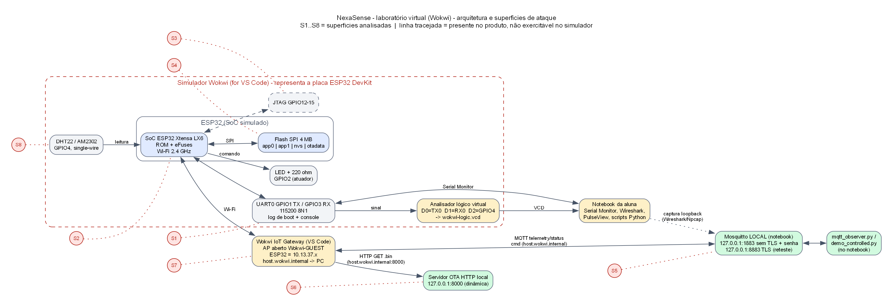

# Arquitetura do NexaSense



Fonte editável: `architecture.dot` (Graphviz). Ambiente: laboratório virtual no Wokwi
(ver `docs/limitacoes-ambiente-virtual.md`).

## Mapa do dispositivo

```
Hardware (ESP32 DevKit, simulado)
├── MCU: ESP32 (Xtensa LX6 dual-core, 520 KB SRAM), ROM bootloader e eFuses
├── Memória: Flash SPI 4 MB, partições default.csv do Arduino-ESP32:
│     nvs 0x9000 | otadata 0xE000 | app0 0x10000 | app1 0x150000 | spiffs 0x290000 | coredump 0x3F0000
├── Sensores: DHT22/AM2302 no GPIO4 (protocolo single-wire)
├── Atuador: LED + resistor 220 Ω no GPIO2
├── Interfaces: UART0 (GPIO1 TX / GPIO3 RX, 115200 8N1); JTAG (GPIO12–15, não simulado);
│     download mode da ROM (GPIO0 + EN)
├── Alimentação (produto): 5 V USB -> regulador 3,3 V
└── Rádio: Wi-Fi 802.11 b/g/n 2,4 GHz
     │
     ▼
Firmware NexaSense 0.9.3-lab (Arduino-ESP32 sobre ESP-IDF)
     │
     ▼
Protocolos: MQTT 3.1.1 sem TLS (1883, usuário/senha) | HTTP :80 /status | OTA por HTTP
     │
     ▼
Serviço associado: broker MQTT local (Mosquitto 127.0.0.1, via host.wokwi.internal) + cliente MQTT + servidor OTA local
```

Confirme no boot o modelo do chip, o MAC e o device id (`nexa-XXXXXX`) e registre o print.

## Relações de confiança

| De → Para | O que o destino confia | Como é verificado hoje |
|---|---|---|
| Sensor → MCU | leitura de temperatura/umidade | só checksum do DHT |
| ROM → bootloader → app | código na Flash é legítimo | nada (Secure Boot desligado) |
| Broker → dispositivo | quem conecta é um NexaSense | usuário/senha **iguais em toda a frota** |
| Dispositivo → broker | o broker é o da NexaHome | nada (sem TLS) |
| Dispositivo → comando MQTT | comando veio do painel autorizado | nada (qualquer cliente com a senha) |
| Dispositivo → servidor OTA | imagem oficial e mais nova | nada (HTTP, sem assinatura, sem versão) |

## Superfícies de ataque

| ID | Superfície | Acesso exigido | Validação no lab virtual |
|---|---|---|---|
| S1 | UART0: log de boot + console de manutenção | físico (pads/conector) | dinâmica (Serial Monitor + VCD) |
| S2 | ROM download mode | físico | documental |
| S3 | JTAG GPIO12–15 | físico + adaptador | documental |
| S4 | Flash SPI (firmware e NVS em claro) | físico | estática (binário) |
| S5 | Broker MQTT / tópico de comando | rede + credencial | dinâmica (PCAP + demonstração) |
| S6 | Mecanismo OTA por HTTP | rede ou credencial MQTT | dinâmica (servidor OTA local) |
| S7 | Rede Wi-Fi / tráfego em claro / HTTP :80 | rede local | dinâmica (captura loopback; `/status` via net.forward) |
| S8 | Barramento do sensor (leitura forjada) | físico | conceitual (sinal visível no canal D2) |
